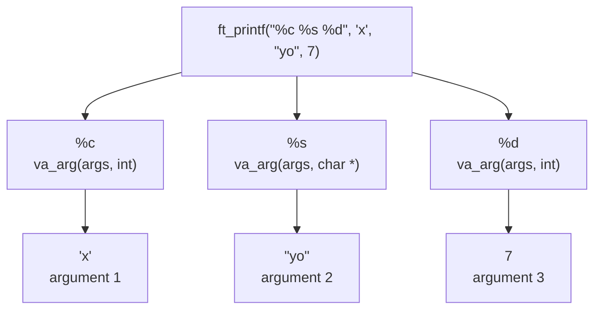
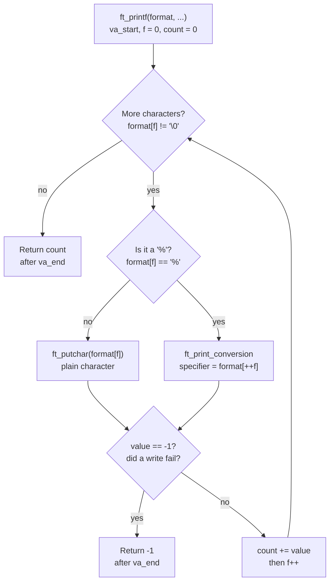
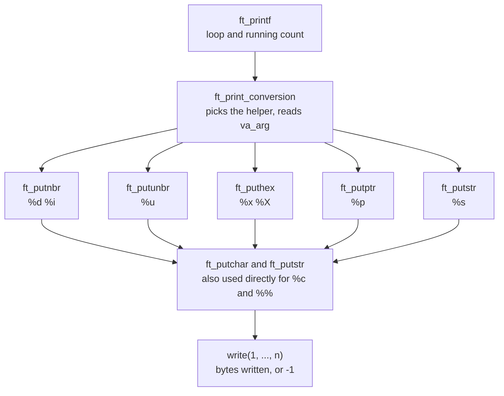

*This project has been created as part of the 42 curriculum by fatel-gh.*

# ft_printf

## Description

**ft_printf** is a re-implementation of the C library function `printf()`.
The project builds a static library, `libftprintf.a`, that exposes one function:

```c
int ft_printf(const char *format, ...);
```

The goal is to learn how **variadic functions** work in C, and how to build a
well-structured, extensible program out of small functions.

> **PRINTF = PRINT FORMAT.**
> The function reads a *format string*. Plain characters are printed as they are,
> and each `%` conversion is replaced by the next argument, formatted according
> to its specifier.

### Supported conversions

| Specifier | Output |
|-----------|--------|
| `%c` | A single character |
| `%s` | A string (`(null)` if the pointer is `NULL`) |
| `%p` | A `void *` pointer in hexadecimal, prefixed with `0x` (`(nil)` if `NULL`) |
| `%d` | A signed decimal number |
| `%i` | A signed integer in base 10 |
| `%u` | An unsigned decimal number |
| `%x` | A number in lowercase hexadecimal |
| `%X` | A number in uppercase hexadecimal |
| `%%` | A percent sign |

The return value is the number of characters printed, or `-1` if a `write` fails.
There is no buffering: every character goes straight to `write(1, ...)`.

### Project structure

| File | Role |
|------|------|
| `ft_printf.c` | Main loop, `ft_print_conversion` dispatcher, `va_list` management |
| `ft_putchar.c` | Prints one character |
| `ft_putstr.c` | Prints a string, handles `NULL` |
| `ft_putnbr.c` | `ft_putunbr` (unsigned) and `ft_putnbr` (signed) |
| `ft_puthex.c` | Prints a number in any base (used for `%x` and `%X`) |
| `ft_putptr.c` | Prints a pointer (`0x` prefix, `(nil)` for `NULL`) |
| `ft_printf.h` | Prototypes and includes |
| `Makefile` | Builds `libftprintf.a` with `ar` |

## Instructions

### Compilation

```bash
make          # builds libftprintf.a at the root of the repository
make clean    # removes the object files
make fclean   # removes the object files and libftprintf.a
make re       # fclean + all
```

The library is compiled with `cc -Wall -Wextra -Werror` and archived with `ar rcs`.

### Usage

Include the header, then link against the library:

```c
#include "ft_printf.h"

int main(void)
{
	int ret;

	ret = ft_printf("%c %s %d\n", 'x', "yo", 7);
	ft_printf("returned: %i\n", ret);
	return (0);
}
```

```bash
cc -Wall -Wextra -Werror main.c -L. -lftprintf -o test
./test
```

To compare with the original, run the same format string through `printf()` and
check that both the output and the return value match.

## Variadic functions and `<stdarg.h>`

A **variadic function** accepts a variable number of arguments: zero or more extra
arguments after the fixed ones. It is declared with an ellipsis (`...`) as its
**final parameter**:

```c
int ft_printf(const char *format, ...);
```

The macros of `<stdarg.h>` give access to those extra arguments:

| Macro | Purpose |
|-------|---------|
| `va_list` | Declares the argument list |
| `va_start` | Initializes the list |
| `va_arg` | Reads the next argument from the list, as the type you ask for |
| `va_end` | Cleans up the list |

In `ft_printf`, the list is initialized with `va_start(arguments, format)`, each
conversion consumes one argument with `va_arg`, and `va_end` is called before every
`return`.



The function cannot know the types of the extra arguments, so the **format string
tells it**. `%c` reads an `int`, `%s` reads a `char *`, and so on. If the format
string and the arguments don't match, the behavior is undefined.

## Algorithm and data structure

### Main loop

`ft_printf` walks through the format string one character at a time with an index
`f`, and keeps a running `count` of printed characters.

- A plain character is printed with `ft_putchar`.
- A `%` followed by a character is handed to `ft_print_conversion`, which receives
  the specifier.
- After each step, if the returned value is `-1`, the function calls `va_end` and
  returns `-1`. Otherwise the value is added to `count`.
- At the end of the string, `va_end` is called and `count` is returned.



**Why this design:** a single linear pass is the simplest correct approach. Each
character is looked at exactly once, there is no allocation, and the format string
is never modified.

### Dispatcher

`ft_print_conversion` is a chain of `if` statements on the specifier. It is the only
place that calls `va_arg`, and it passes the value to the helper that prints it.
Each helper returns the number of bytes it printed, or `-1` on failure.



Every level returns the number of bytes printed, or `-1` on failure.

**Why this design:** the parsing (main loop), the dispatching (`ft_print_conversion`)
and the printing (helpers) are separate. Adding a new conversion means writing one
helper and adding one line to the dispatcher, without touching the main loop. This
is what the subject calls *well-structured and extensible code*.

### Number printing: the divisor method

`ft_putunbr` and `ft_puthex` don't use a buffer or recursion. They compute the
largest power of the base that is `<= n` (called `div`), then print one digit at a
time:

1. `div` starts at `1` and is multiplied by the base while `n / div >= base`.
2. The digit is `n / div`, printed with `ft_putchar`.
3. `n` becomes `n % div`, and `div` is divided by the base.
4. The loop ends when `div` reaches `0`.

`ft_puthex` takes the digit set as a string (`"0123456789abcdef"` or
`"0123456789ABCDEF"`) and computes the base from its length. One function handles
both `%x` and `%X`, and the same method would work for any other base.

**Why this design:** digits come out in the correct order without reversing a
string, and no memory is allocated, so there can be no leak. The cost is a small
extra loop to find the divisor.

### Signed numbers

`ft_putnbr` prints `-` for negative numbers, then converts the value to
`unsigned int` and calls `ft_putunbr`. This avoids overflow on `INT_MIN`, because
`-INT_MIN` does not fit in an `int` but does fit in an `unsigned int`.

### Pointers

`ft_putptr` prints `0x`, then the address in lowercase hexadecimal. The address is
converted with `uintptr_t` so that it is wide enough for any pointer. A `NULL`
pointer prints `(nil)`, as glibc does on Linux.

### Error handling and return value

Every printing function returns the number of bytes written, or `-1` if `write`
fails. Each level checks the result of the level below and stops immediately on
`-1`. The total can therefore be trusted as the return value of `ft_printf`, just
like `printf()`.

## Resources

### Documentation

- `man 3 printf`: behavior of the original function
- `man 3 stdarg`: `va_list`, `va_start`, `va_arg`, `va_end`, `va_copy`
- `man 2 write`: system call used for all output
- `man 1 ar`: creating the static library

### References and tutorials

- [GNU C Library manual, Variadic Functions](https://www.gnu.org/software/libc/manual/html_node/Variadic-Functions.html): how variadic functions are declared and used
- [GNU C Library manual, Formatted Output](https://www.gnu.org/software/libc/manual/html_node/Formatted-Output.html): the behavior of each conversion
- [cppreference, Variadic arguments](https://en.cppreference.com/w/c/variadic): `<stdarg.h>` macros, with examples and notes on undefined behavior
- [cppreference, printf family](https://en.cppreference.com/w/c/io/fprintf): format specifiers and return values
- [man7.org, printf(3)](https://man7.org/linux/man-pages/man3/printf.3.html) and [stdarg(3)](https://man7.org/linux/man-pages/man3/stdarg.3.html): online versions of the man pages
- [GNU Binutils, ar](https://sourceware.org/binutils/docs/binutils/ar.html): creating and indexing static libraries
- [GNU Make manual](https://www.gnu.org/software/make/manual/make.html): pattern rules, dependencies and `.PHONY` used in the Makefile
- *The C Programming Language* (Kernighan & Ritchie), section 7.3 "Variable-length Argument Lists", which builds a minimal `printf`

### AI usage

AI was used as a learning aid, and not to write the project:

- **Stack Overflow AI Assist** (based on community answers) was used to understand
  concepts and look up behaviors, such as how `va_list` works and how glibc handles
  `NULL` pointers.
- The code was written and tested by me.
